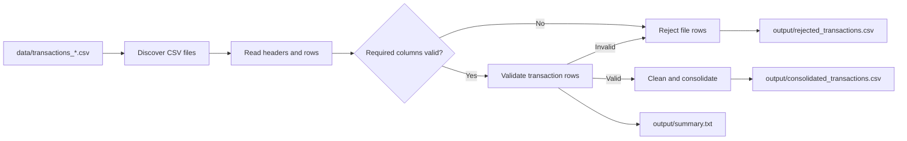

# Soko Fresh Multi-File Transaction Pipeline

A Python data-engineering pipeline that processes daily Soko Fresh supermarket transaction CSV files, validates their contents, separates accepted and rejected rows, and produces a consolidated dataset plus a processing summary.

## Features

- Discovers transaction files matching `transactions_*.csv`
- Validates required columns before processing each file
- Removes files with missing required columns from normal processing and reports their rows as rejected
- Checks required values, numeric quantity and unit price, positive values, and duplicate transaction IDs across a run
- Writes cleaned accepted transactions and rejected rows to separate CSV files
- Generates a text summary with discovered, processed, rejected, read, accepted, and rejected row counts

## Pipeline Workflow



## Requirements

- Python 3.14 or newer
- `pandas` 3.1.0 or newer, as declared in `pyproject.toml`

> [!NOTE]
> The pipeline currently performs CSV processing with the Python standard library. Pandas is declared as a project dependency but is not required by the implemented pipeline functions.

## Installation

From the project directory, create and activate a virtual environment, then install the project dependencies:

```bash
python -m venv .venv
source .venv/Scripts/activate
python -m pip install -e .
```

On PowerShell, activate the environment with:

```powershell
.\.venv\Scripts\Activate.ps1
```

## Usage

Run the pipeline with its default input and output directories:

```bash
python pipeline.py
```

You can specify custom paths with command-line arguments:

```bash
python pipeline.py --input data/ --output output/
```

Each run produces:

| Output | Description |
|---|---|
| `output/consolidated_transactions.csv` | Valid, cleaned transactions |
| `output/rejected_transactions.csv` | Rejected rows and their rejection reasons |
| `output/summary.txt` | Counts for files and transactions processed |

## Input Schema

Every transaction file must contain these required columns:

- `transaction_id`
- `date`
- `branch`
- `customer_id`
- `product`
- `quantity`
- `unit_price`
- `payment_method`

Additional columns are accepted. The pipeline attaches `_source_file` to each row so the originating CSV remains traceable.

## Validation Rules

A transaction row is rejected when:

- Any required value is blank
- `quantity` is missing, non-numeric, or not greater than zero
- `unit_price` is missing, non-numeric, or not greater than zero
- Its `transaction_id` duplicates a valid ID already seen in the same run

A transaction ID is marked as seen only after that row passes validation. Files with missing required headers are skipped, and their rows are written to the rejected output with a missing-column reason.

## Testing

Run the test module with pytest from the project directory:

```bash
python -m pytest test_pipeline.py
```

## Project Structure

```text
.
├── pipeline.py
├── pyproject.toml
├── requirements.txt
├── test_pipeline.py
├── data/
│   └── transactions_YYYY-MM-DD.csv
├── output/
│   ├── consolidated_transactions.csv
│   ├── rejected_transactions.csv
│   └── summary.txt
└── src/
    └── day2_multi_file_pipeline/
        └── __init__.py
```
